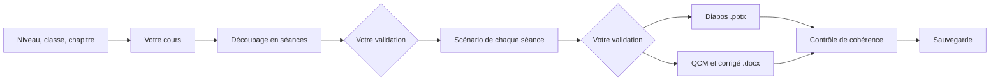

# Prépa Cours

[](https://github.com/d3Ita/prepa-cours/actions/workflows/tests.yml)
[](LICENSE)

**Gardez tous vos cours bien rangés par niveau, classe et chapitre. Donnez un cours en Word, LibreOffice ou texte, indiquez la matière, vos heures et vos séances : récupérez pour chaque séance un scénario minuté, des diapos et un QCM de 5 questions, dans des fichiers que vous pouvez retoucher avec PowerPoint, Word ou LibreOffice.**

*Claude Code plugin that organizes a teacher's courses by level, class and chapter, and fits a course to a subject and a given number of hours and sessions, then produces a lesson plan, slides and a 5-question quiz for each session, with version history. The plugin speaks French.*

> **Version 0.5 : préversion.** Les scripts sont testés automatiquement, mais le parcours complet avec les agents n'a pas encore été éprouvé sur de vrais cours. Relisez toujours ce qui est produit, surtout les corrigés, avant de l'utiliser en classe.

## Vos cours bien rangés

Tous vos cours vivent dans un seul dossier, toujours organisé de la même façon :

```text
Dossier de cours/
└── Terminale/                       ← niveau
    └── Terminale 2/                 ← classe
        └── Chapitre 01 - Génétique/ ← chapitre
            ├── Cours/        votre cours et les scénarios de séance
            ├── Diapos/       les diapos
            ├── QCM/          les QCM à imprimer
            ├── Evaluations/  les évaluations à imprimer
            └── Corrections/  les corrigés
```

Vous pouvez demander à tout moment : « montre-moi mes cours de Terminale », « range ces fichiers » ou « réutilise ce chapitre pour la Terminale 3 ». Le plugin vous montre son classement avant de ranger des fichiers existants, les copie par défaut et ne supprime rien. Vous pouvez aussi lancer `/prepa-cours:organiser`.

## Comment ça marche



| Rôle | Ce qu'il fait |
| --- | --- |
| **Superviseur** (`/prepa-cours:cours`) | Enchaîne les étapes, attend votre validation et contrôle la cohérence |
| **Organisation** (`/prepa-cours:organiser`) | Classe vos cours par niveau, classe et chapitre, et réutilise un chapitre pour une autre classe |
| **Découpage** (`/prepa-cours:decoupage`) | Adapte le cours à vos heures et à vos séances, ou réajuste un découpage existant |
| **Scénariste** | Écrit le déroulé minuté de chaque séance, côté prof et côté élèves |
| **Concepteur de diapos** | Crée les diapos et les notes du présentateur, avec le modèle de votre établissement si vous en avez un |
| **Évaluateur** | Crée le QCM de 5 questions de chaque séance et son corrigé, et une évaluation finale si vous en voulez une |
| **Versions** (`/prepa-cours:versions`) | Sauvegarde, compare et restaure vos fichiers |

## Niveaux et matières

Tous les agents s'adaptent à votre classe avant d'écrire.

- **Niveaux :** de la 6e au post-bac, avec notamment la Seconde, la Première et la Terminale. Le niveau règle le vocabulaire, le rythme des activités et la difficulté des QCM.
- **Matières :** SVT, mathématiques, physique-chimie, français, histoire-géographie, SES, philosophie, langues vivantes et informatique/NSI, avec un profil général pour les autres matières. Chaque profil règle la démarche, les activités, les diapos, les QCM et les erreurs à éviter.

Ces repères ne remplacent ni votre cours ni le programme officiel, que le plugin ne cite pas. Une notion qui semble hors du niveau vous est signalée sans être retirée. Pour ajouter une matière, il suffit d'ajouter un fichier dans [`references/matieres`](references/matieres).

## Contrôle et exemples

Le contrôle de cohérence vérifie notamment que le temps de chaque séance correspond à votre découpage, que chaque objectif est traité et que chaque QCM a bien 5 questions avec une réponse valide. Toute information qui ne vient pas de votre cours est signalée par `[À VÉRIFIER]`.

Si le cours ne tient pas dans les heures prévues, le plugin vous propose quoi condenser ou passer en travail personnel. Il ne supprime rien sans votre accord.

Le dossier [`exemples`](exemples) montre l'organisation et le format des fichiers produits, avec un chapitre sur la photosynthèse en 5e (2 séances de 55 min) et un faux cours sur les systèmes agentiques en licence 3 (3 séances de 2 h). Ces exemples ont été écrits à la main en suivant les consignes du plugin : ce ne sont pas des sorties réelles de ses agents.

## Installation

Il vous faut [Claude Code](https://code.claude.com/docs), [Python 3](https://www.python.org/downloads/) et [Git](https://git-scm.com/downloads). Dans Claude Code, tapez :

```text
/plugin marketplace add d3Ita/prepa-cours
/plugin install prepa-cours@prepa-cours
```

Internet est nécessaire à la première génération de fichiers, pour installer `python-pptx` et `python-docx`. Le plugin peut vous demander votre dossier de cours à l'activation. Sinon, il vous le demandera à la première utilisation.

## Utilisation

Indiquez votre document (`.docx`, `.odt` ou `.txt`), votre classe, votre chapitre et vos heures :

```text
/prepa-cours:cours mon-cours.docx Terminale 2, SVT, chapitre Génétique, 12 h en 6 séances de 2 h
```

Les séances peuvent aussi avoir des durées différentes : « 3 séances de 2 h, puis 2 séances d'1 h 30 ». Vous obtenez dans le dossier du chapitre :

| Fichier | Contenu |
| --- | --- |
| `Cours/mon-cours.docx` | Une copie de votre cours |
| `Cours/seance-1-scenario.docx` | Le déroulé de la séance |
| `Diapos/seance-1-diapos.pptx` | Les diapos et les notes du présentateur |
| `QCM/seance-1-qcm.docx` | Le QCM de 5 questions à imprimer |
| `Corrections/seance-1-qcm-corrige.docx` | Le corrigé du QCM |
| `Evaluations/evaluation.docx` | L'évaluation finale, si vous en demandez une |
| `Corrections/evaluation-corrige.docx` | Son corrigé |

Les mêmes fichiers sont créés pour chaque séance. Un dossier caché, `.travail`, contient les textes de travail du plugin : ne le supprimez pas, car il sert aux mises à jour et aux contrôles.

Si vos heures changent en cours d'année, dites-le simplement, par exemple : « je n'ai plus que 4 séances ». Le plugin vous montre ce que cela change et ne refait que les séances concernées après votre accord.

Pour vos versions, demandez simplement : « sauvegarde mon cours », « qu'est-ce qui a changé depuis hier ? » ou « reviens aux diapos de lundi ». Vous pouvez aussi lancer `/prepa-cours:versions`.

Vos retouches sont protégées : le plugin n'écrase jamais un fichier existant sans vous le demander, et il sauvegarde avant de restaurer une ancienne version.

## Vos données

- **Ce qui part :** les documents que Claude lit sont envoyés à Anthropic pour être traités, comme dans toute conversation avec Claude.
- **Ce qui reste chez vous :** les sauvegardes sont locales et le plugin n'envoie rien vers GitHub ou un autre serveur.
- **Élèves :** ne donnez ni noms, ni notes, ni copies. Cette version ne corrige pas les copies, précisément pour éviter de traiter ces données personnelles.

## Limites

- Les anciens fichiers Word `.doc` ne sont pas lus : enregistrez-les d'abord en `.docx`.
- Le plugin ne lit que le texte de votre cours, pas ses images.
- Les formules complexes ne sont pas mises en forme : elles sont signalées `[FORMULE À SAISIR]` pour que vous les saisissiez dans l'éditeur d'équations.
- La durée de chaque notion est une estimation : ajustez-la selon votre classe.
- Réutiliser un chapitre crée une copie par classe : une modification ne se répercute pas sur les autres classes.
- Les sauvegardes ne protègent pas d'une panne de disque : copiez aussi le dossier de cours ailleurs.
- La comparaison de versions porte sur le texte, pas sur les images ni la mise en forme.
- Deux versions modifiées en parallèle ne peuvent pas être fusionnées automatiquement.
- Les diapos sont au format `.pptx`, que LibreOffice ouvre. Le rendu peut varier selon le logiciel et le modèle utilisé.
- Le plugin n'invente pas d'images : il utilise celles que vous fournissez.
- Il a été conçu pour Claude Code. L'usage sur claude.ai ou Cowork n'a pas été testé.

## Contribuer

Les retours d'enseignants sont les plus précieux : [ouvrez une issue](https://github.com/d3Ita/prepa-cours/issues) pour signaler un problème ou raconter ce qui vous manque.

```bash
pip install python-pptx==1.0.2 python-docx==1.2.0
```

```bash
python3 -m unittest discover tests
```

## Licence

[MIT](LICENSE)
