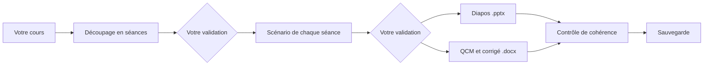

# Prof Cours

[](https://github.com/d3Ita/prof-cours/actions/workflows/tests.yml)
[](LICENSE)

**Donnez votre cours en Word, LibreOffice ou texte, indiquez vos heures et vos séances : récupérez pour chaque séance un scénario minuté, des diapos et un QCM de 5 questions, dans des fichiers que vous pouvez retoucher avec PowerPoint, Word ou LibreOffice.**

*Claude Code plugin that fits a teacher's course to a given number of hours and sessions, then produces a lesson plan, slides and a 5-question quiz for each session, with version history. The plugin speaks French.*

> **Version 0.3 : préversion.** Les scripts sont testés automatiquement, mais le parcours complet avec les agents n'a pas encore été éprouvé sur de vrais cours. Relisez toujours ce qui est produit, surtout les corrigés, avant de l'utiliser en classe.

## Comment ça marche



| Rôle | Ce qu'il fait |
| --- | --- |
| **Superviseur** (`/prof-cours:cours`) | Enchaîne les étapes, attend votre validation et contrôle la cohérence |
| **Découpage** (`/prof-cours:decoupage`) | Adapte le cours à vos heures et à vos séances, ou réajuste un découpage existant |
| **Scénariste** | Écrit le déroulé minuté de chaque séance, côté prof et côté élèves |
| **Concepteur de diapos** | Crée les diapos et les notes du présentateur, avec le modèle de votre établissement si vous en avez un |
| **Évaluateur** | Crée le QCM de 5 questions de chaque séance et son corrigé, et une évaluation finale si vous en voulez une |
| **Versions** (`/prof-cours:versions`) | Sauvegarde, compare et restaure vos fichiers |

Le contrôle de cohérence vérifie notamment que le temps de chaque séance correspond à votre découpage, que chaque objectif est traité et que chaque QCM a bien 5 questions avec une réponse valide. Toute information qui ne vient pas de votre cours est signalée par `[À VÉRIFIER]`.

Si le cours ne tient pas dans les heures prévues, le plugin vous propose quoi condenser ou passer en travail personnel. Il ne supprime rien sans votre accord.

Deux exemples montrent le format des fichiers produits. Ils ont été écrits à la main en suivant les consignes du plugin, et ne sont donc pas des sorties réelles de ses agents :

- [`exemples/photosynthese`](exemples/photosynthese) : 2 séances de 55 min en 5e, avec par exemple les [diapos](exemples/photosynthese/seance-1/diapos.pptx) et le [QCM](exemples/photosynthese/seance-1/qcm.docx) de la séance 1.
- [`exemples/systemes-agentiques`](exemples/systemes-agentiques) : un faux cours en licence 3 informatique, de 6 h en 3 séances de 2 h, à partir d'un [cours Word](exemples/systemes-agentiques/cours-source.docx).

## Installation

Il vous faut [Claude Code](https://code.claude.com/docs), [Python 3](https://www.python.org/downloads/) et [Git](https://git-scm.com/downloads). Dans Claude Code, tapez :

```text
/plugin marketplace add d3Ita/prof-cours
/plugin install prof-cours@prof-cours
```

Internet est nécessaire à la première génération de fichiers, pour installer `python-pptx` et `python-docx`.

## Utilisation

Ouvrez Claude Code dans le dossier de votre cours, avec votre document dedans (`.docx`, `.odt` ou `.txt`), puis indiquez vos heures :

```text
/prof-cours:cours mon-cours.docx 12 h en 6 séances de 2 h
```

Les séances peuvent aussi avoir des durées différentes : « 3 séances de 2 h, puis 2 séances d'1 h 30 ». Vous obtenez dans ce dossier :

| Fichier | Contenu |
| --- | --- |
| `objectifs.md` | Les objectifs et le découpage validés |
| `seance-1/scenario.docx` | Le déroulé de la séance |
| `seance-1/diapos.pptx` | Les diapos et les notes du présentateur |
| `seance-1/qcm.docx` | Le QCM de 5 questions à imprimer |
| `seance-1/qcm-corrige.docx` | Le corrigé du QCM |
| `seance-2/`, `seance-3/`… | Les mêmes fichiers pour chaque séance |
| `evaluation.docx`, `corrige.docx` | L'évaluation finale, si vous en demandez une |

Les fichiers `.md` sont les textes de travail du plugin : vous n'avez pas besoin de les ouvrir.

Si vos heures changent en cours d'année, dites-le simplement, par exemple : « je n'ai plus que 4 séances ». Le plugin vous montre ce que cela change et ne refait que les séances concernées après votre accord.

Pour vos versions, demandez simplement : « sauvegarde mon cours », « qu'est-ce qui a changé depuis hier ? » ou « reviens aux diapos de lundi ». Vous pouvez aussi lancer `/prof-cours:versions`.

Vos retouches sont protégées : le plugin n'écrase jamais un fichier existant sans vous le demander, et il sauvegarde avant de restaurer une ancienne version.

## Vos données

- **Ce qui part :** les documents que Claude lit sont envoyés à Anthropic pour être traités, comme dans toute conversation avec Claude.
- **Ce qui reste chez vous :** les sauvegardes sont locales et le plugin n'envoie rien vers GitHub ou un autre serveur.
- **Élèves :** ne donnez ni noms, ni notes, ni copies. Cette version ne corrige pas les copies, précisément pour éviter de traiter ces données personnelles.

## Limites

- Les anciens fichiers Word `.doc` ne sont pas lus : enregistrez-les d'abord en `.docx`.
- Le plugin ne lit que le texte de votre cours, pas ses images.
- La durée de chaque notion est une estimation : ajustez-la selon votre classe.
- Les sauvegardes ne protègent pas d'une panne de disque : copiez aussi le dossier du cours ailleurs.
- La comparaison de versions porte sur le texte, pas sur les images ni la mise en forme.
- Deux versions modifiées en parallèle ne peuvent pas être fusionnées automatiquement.
- Les diapos sont au format `.pptx`, que LibreOffice ouvre. Le rendu peut varier selon le logiciel et le modèle utilisé.
- Le plugin n'invente pas d'images : il utilise celles que vous fournissez.
- Il a été conçu pour Claude Code. L'usage sur claude.ai ou Cowork n'a pas été testé.

## Contribuer

Les retours d'enseignants sont les plus précieux : [ouvrez une issue](https://github.com/d3Ita/prof-cours/issues) pour signaler un problème ou raconter ce qui vous manque.

```bash
pip install python-pptx==1.0.2 python-docx==1.2.0
```

```bash
python3 -m unittest discover tests
```

## Licence

[MIT](LICENSE)
