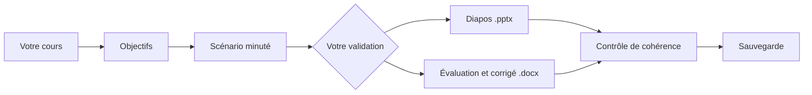

# Prof Cours

[](https://github.com/d3Ita/prof-cours/actions/workflows/tests.yml)
[](LICENSE)

**Donnez votre cours à Claude, récupérez un scénario minuté, des diapos et une évaluation avec son corrigé, dans des fichiers que vous pouvez retoucher avec PowerPoint, Word ou LibreOffice.**

*Claude Code plugin that turns a teacher's course material into a lesson plan, slides and an assessment, with version history. The plugin speaks French.*

> **Version 0.2 : préversion.** Les scripts sont testés automatiquement, mais le parcours complet avec les agents n'a pas encore été éprouvé sur de vrais cours. Relisez toujours ce qui est produit, surtout les corrigés, avant de l'utiliser en classe.

## Comment ça marche



| Rôle | Ce qu'il fait |
| --- | --- |
| **Superviseur** (`/prof-cours:cours`) | Enchaîne les étapes, attend votre validation et contrôle la cohérence |
| **Scénariste** | Écrit le déroulé minuté de la séance, côté prof et côté élèves |
| **Concepteur de diapos** | Crée les diapos et les notes du présentateur, avec le modèle de votre établissement si vous en avez un |
| **Évaluateur** | Crée le sujet à imprimer, les lignes de réponse, le barème et le corrigé |
| **Versions** (`/prof-cours:versions`) | Sauvegarde, compare et restaure vos fichiers |

Le contrôle de cohérence vérifie que chaque objectif est présent partout, que le minutage correspond à la durée de la séance et que le barème correspond au total annoncé. Toute information qui ne vient pas de votre cours est signalée par `[À VÉRIFIER]`.

Un exemple complet se trouve dans [`exemples/photosynthese`](exemples/photosynthese), avec les [diapos](exemples/photosynthese/diapos.pptx) et l'[évaluation](exemples/photosynthese/evaluation.docx) générées.

## Installation

Il vous faut [Claude Code](https://code.claude.com/docs), [Python 3](https://www.python.org/downloads/) et [Git](https://git-scm.com/downloads). Dans Claude Code, tapez :

```text
/plugin marketplace add d3Ita/prof-cours
/plugin install prof-cours@prof-cours
```

Internet est nécessaire à la première génération de fichiers, pour installer `python-pptx` et `python-docx`.

## Utilisation

Ouvrez Claude Code dans le dossier de votre cours, avec vos documents dedans (`.pptx`, `.docx`, `.odp`, `.odt`, `.pdf` ou texte), puis tapez :

```text
/prof-cours:cours
```

Vous obtenez dans ce dossier :

| Fichier | Contenu |
| --- | --- |
| `scenario.docx` | Le déroulé de la séance |
| `diapos.pptx` | Les diapos et les notes du présentateur |
| `evaluation.docx` | Le sujet à imprimer |
| `corrige.docx` | Le corrigé et les critères de notation |
| `objectifs.md`, `scenario.md`, `diapos.md`… | Les textes de travail du plugin |

Pour vos versions, demandez simplement : « sauvegarde mon cours », « qu'est-ce qui a changé depuis hier ? » ou « reviens aux diapos de lundi ». Vous pouvez aussi lancer `/prof-cours:versions`.

Vos retouches sont protégées : le plugin n'écrase jamais un fichier existant sans vous le demander, et il sauvegarde avant de restaurer une ancienne version.

## Vos données

- **Ce qui part :** les documents que Claude lit sont envoyés à Anthropic pour être traités, comme dans toute conversation avec Claude.
- **Ce qui reste chez vous :** les sauvegardes sont locales et le plugin n'envoie rien vers GitHub ou un autre serveur.
- **Élèves :** ne donnez ni noms, ni notes, ni copies. Cette version ne corrige pas les copies, précisément pour éviter de traiter ces données personnelles.

## Limites

- Les sauvegardes ne protègent pas d'une panne de disque : copiez aussi le dossier du cours ailleurs.
- La comparaison de versions porte sur le texte, pas sur les images ni la mise en forme.
- Deux versions modifiées en parallèle ne peuvent pas être fusionnées automatiquement.
- Les diapos sont au format `.pptx`, que LibreOffice ouvre. Le rendu peut varier selon le logiciel et le modèle utilisé.
- Le plugin n'invente pas d'images : il utilise celles que vous fournissez.
- Il a été conçu pour Claude Code. L'usage sur claude.ai ou Cowork n'a pas été testé.

## Contribuer

Les retours d'enseignants sont les plus précieux : [ouvrez une issue](https://github.com/d3Ita/prof-cours/issues) pour signaler un problème ou raconter ce qui vous manque.

```bash
pip install python-pptx==1.0.2 python-docx==1.2.0
```

```bash
python3 -m unittest discover tests
```

## Licence

[MIT](LICENSE)
